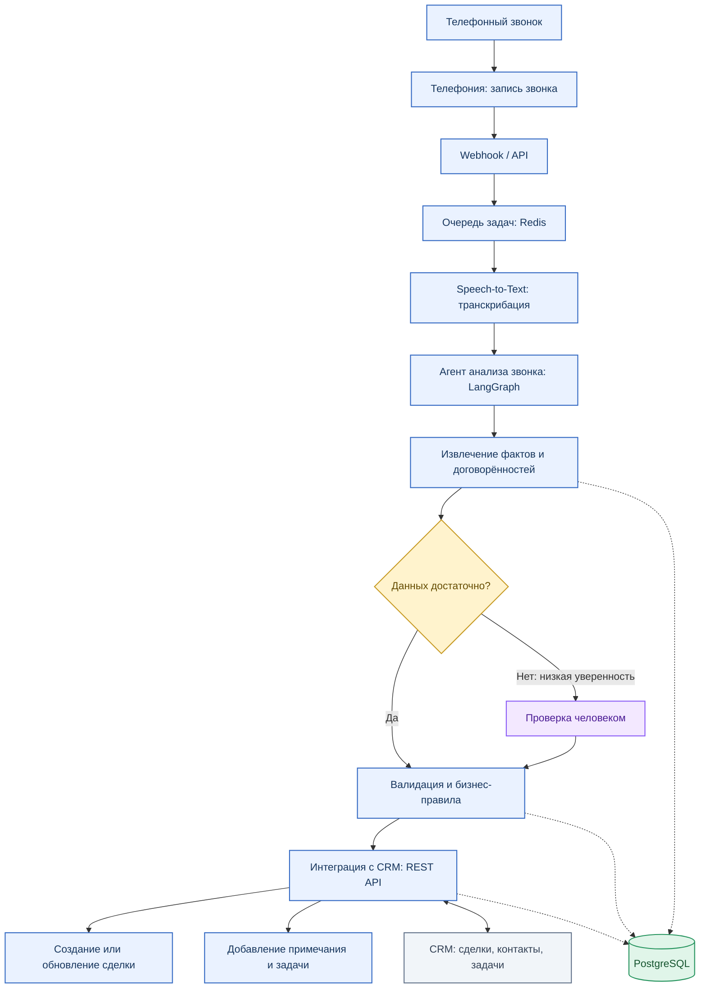

# Проверка задач в amoCRM (LangGraph)

Проверяет сделки, у которых нет связанных задач либо имеются просроченные или незавершенные задачи.

## Установка и тест

```bash
python -m venv .venv
.venv\Scripts\activate
pip install -r requirements.txt
python -m pytest -v
```

В тестах используются фиктивные данные, и вызовы к amoCRM не выполняются. Для реального запуска установите переменные `AMO_SUBDOMAIN` и `AMO_TOKEN`, а затем выполните `python main.py`.



## Основные компоненты системы:

1. Приём звонков. Телефония предоставляет запись разговора и идентификаторы звонка, клиента и оператора. После завершения звонка сервис получает уведомление через webhook или запрашивает данные через API провайдера. Если телефония поддерживает потоковое аудио, возможна обработка в реальном времени.

2. Очередь задач. Redis используется совместно с очередью фоновых задач, например Celery. Это позволяет обрабатывать несколько звонков параллельно, повторять неудачные операции и не блокировать основной API во время длительной транскрибации.

3. Speech-to-Text. Отдельный сервис преобразует аудиозапись в текст с временными метками и, если поддерживается, разделением реплик по говорящим. Можно использовать облачный API распознавания речи или развернуть модель внутри инфраструктуры компании.

4. Агент анализа звонка. LangGraph управляет последовательностью шагов. LLM анализирует транскрипт и формирует структурированный результат: краткое содержание, потребность клиента, интересующий продукт, бюджет при наличии, возражения, договорённости, следующий шаг и признаки необходимости передачи менеджеру. Результат проверяется по заданной Pydantic-схеме.

5. Валидация и бизнес-логика. Обычный Python-код проверяет обязательные поля, идентификаторы клиента, допустимые значения и правила создания задач. LLM не должен самостоятельно придумывать сведения о клиенте или принимать критические решения без проверок. При низкой уверенности, конфликтующих данных или нестандартной ситуации результат направляется сотруднику на проверку.

6. Интеграция с CRM. CRM-адаптер обращается к REST API, например amoCRM, чтобы найти контакт или сделку, добавить примечание с итогами разговора, обновить разрешённые поля и создать задачу с ответственным и сроком выполнения. Доступ к CRM осуществляется через токены с минимально необходимыми правами. Перед повторной записью результата проверяется идентификатор звонка, чтобы избежать дубликатов.

Хранение результатов

PostgreSQL хранит метаданные звонка, идентификаторы клиента и сделки, статус обработки, транскрипт или ссылку на него, структурированный результат анализа, ошибки и историю синхронизации с CRM. Сами аудиозаписи целесообразно хранить в защищённом объектном хранилище, а в БД — ссылку и метаданные. Доступ к записям ограничивается согласно политике компании и требованиям к персональным данным.

Для устойчивости обработки используются статусы задач, повторные попытки с ограничением количества, логирование и мониторинг ошибок. Секреты API хранятся в переменных окружения или менеджере секретов.

Технологический стек:
Python, FastAPI — API и приём webhook.
LangGraph, LLM — управление этапами анализа и ветвлением процесса.
Speech-to-Text API — преобразование аудио в текст.
Celery, Redis — фоновые задачи и параллельная обработка.
PostgreSQL, SQLAlchemy — хранение результатов и метаданных.
CRM REST API — получение и обновление сделок, контактов и задач.
OpenTelemetry и LangSmith — наблюдаемость, трассировка шагов и поиск ошибок при наличии соответствующей интеграции.

Архитектура разделяет вероятностную работу LLM и детерминированную бизнес-логику. Благодаря этому систему можно расширять новыми сценариями обработки звонков, сохраняя единый механизм интеграции с CRM и контроля качества.


Я бы оставил одного основного агента анализа звонка, а распознавание речи, работу с CRM, валидацию и сохранение результатов сделал отдельными сервисами или обычными функциями. Не каждый компонент должен быть агентом: это увеличивает сложность, стоимость и количество ошибок.


## 2. Автоматизация, участие человека и основные риски

Что система делает самостоятельно

Система автоматически обрабатывает завершённые звонки и выполняет следующие действия:

Получает запись разговора и метаданные звонка из телефонии.

Преобразует аудио в текст с помощью Speech-to-Text.

Анализирует разговор с помощью LLM: формирует краткое содержание, определяет потребности клиента, выявляет возражения и извлекает договорённости.

Формирует структурированный результат: следующий шаг, ответственный сотрудник, предполагаемый срок выполнения и другие важные сведения, если они присутствуют в разговоре.

Находит соответствующий контакт или сделку в CRM и проверяет наличие необходимых данных.

По заданным бизнес-правилам добавляет примечание, обновляет разрешённые поля и создаёт задачи.

Сохраняет результаты обработки, фиксирует ошибки и повторяет временно неудачные операции.

Что система передаёт человеку

Участие сотрудника требуется в ситуациях, когда автоматическое решение может быть ненадёжным или привести к нежелательным последствиям:

Низкая уверенность в результате: плохое качество записи, неразборчивая речь, противоречивые сведения или невозможность определить нужного клиента.

Неоднозначные договорённости: неясные сроки, сумма сделки, обязательства сторон или следующий шаг.

Нестандартные ситуации: жалоба, конфликт, запрос на особые условия, необходимость согласования скидки или коммерческого предложения.

Критические изменения в CRM: закрытие сделки, изменение ответственного, изменение важных коммерческих условий или другие действия, для которых предусмотрено ручное подтверждение.

При необходимости сотрудник проверяет транскрипт и извлечённые данные, исправляет ошибки и подтверждает действие. После подтверждения система продолжает процесс. Обычные операции с высокой уверенностью могут выполняться автоматически в пределах установленных прав.

## Три главных риска и ограничения

1. Ошибки распознавания и анализа речи.

Шум, акценты, перебивания и сложные формулировки могут привести к неправильной транскрибации или неверному извлечению договорённостей. LLM также может сделать ошибочный вывод или сформулировать факт, которого не было в разговоре.

Снижение риска: проверка структуры и обязательных полей, сопоставление извлечённых фактов с транскриптом, пороги уверенности и ручная проверка неоднозначных случаев.

2. Ошибочные изменения в CRM и дублирование операций.

Система может выбрать не ту сделку, создать повторную задачу или перезаписать важные сведения. Дополнительные проблемы возможны из-за ограничений API, ошибок сети и превышения лимитов запросов.

Снижение риска: проверка идентификаторов и прав доступа, идемпотентность операций, повторные попытки с ограничениями, журналирование изменений и подтверждение критических действий человеком.

3. Персональные данные, безопасность и зависимость от внешних сервисов.

Записи звонков и транскрипты могут содержать персональные или коммерчески чувствительные сведения. Передача данных внешним LLM- и Speech-to-Text-провайдерам создаёт дополнительные требования к безопасности. Недоступность этих сервисов также может задержать обработку звонков.

Снижение риска: минимизация передаваемых данных, разграничение доступа, шифрование, ограничение сроков хранения, соблюдение требований законодательства и возможность повторной обработки после восстановления сервисов.

## Принцип работы

Система автоматизирует типовые операции, но не заменяет сотрудника при неоднозначных, критических или требующих человеческого решения ситуациях. Цель — сократить ручную работу менеджера, сохранив контроль над качеством данных и действиями в CRM.